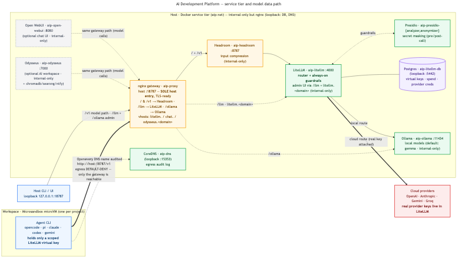

# AI Development Platform — architecture

This is the canonical architecture reference for the `ai` platform: the container
topology, the model data path, and per-session agent sandboxing. For the exact CLI
surface see `spec/04-cli-specification.md`; for the full end-state design see
`spec/01-architecture-spec.md`; for narrative implementation detail see `AGENTS.md`.

The **canonical diagram** is [`docs/architecture.mmd`](architecture.mmd) (Mermaid
source — includes every service: proxy, headroom, litellm + DB, presidio, valkey,
redisinsight, dns). Its rendered export is embedded below.

> **Note:** after any architecture change, edit `docs/architecture.mmd` and
> regenerate the PNG from it (`make diagram`, which runs `mmdc -i
> docs/architecture.mmd -o docs/architecture.png`). Do not hand-maintain a separate
> diagram elsewhere — the single source avoids drift.

## End-to-end flow

A coding agent CLI (opencode, claude-code, codex, gemini, omp, or hermes) runs as
an ordinary **host process**, sandboxed per-invocation by **[nono](https://nono.sh)**
— a kernel-capability sandboxing tool (Landlock LSM on Linux, Seatbelt on macOS),
**not** a virtual machine. This is a deliberate, accepted security-model change
from the platform's previous Microsandbox-microVM design: nono is same-kernel
process sandboxing, not hardware/VM isolation. There is no guest OS, no image to
build, and no boot step — a "workspace" is just a registered project directory
(`internal/project`) plus a generated nono profile (`internal/nono`, JSON at
`<project>/.ai-platform/nono-profile-<cli>.json`) that grants filesystem access
scoped to the project directory and a network policy. Every `ai agent <cli>` or
`ai shell` launch is its own nono session (`nono run --detached` / `nono shell`),
started, listed, reattached, and stopped independently via nono's own session
lifecycle (`ai sessions`, `ai attach`, `ai stop`).

The sandboxed CLI speaks the OpenAI API to the host gateway — by default plain
loopback `http://127.0.0.1:18787/v1` (a remote gateway can be set machine-wide
with `ai gateway set`) — authenticating with a **scoped LiteLLM virtual key**: a
fresh key is minted per launch (revoking any prior one for the project) and
handed to the sandboxed process only via nono's `--env-credential-map`, resolved
from the OS keychain (macOS Keychain / Linux `secret-tool`) at launch time — the
real key is never written to a config file or the project directory, and never
touches platform disk. Workspace egress defaults to **"public"** (nono's own
unrestricted-outbound default — the open internet is reachable while private
ranges stay blocked); a project can allow- or deny-list individual domains
(`ai network allow|disallow <domain>`, `*.suffix` wildcards supported) or be
locked down entirely with `ai network egress deny`. Separately, every DNS name
resolved host-wide (across all workspaces) is logged for audit by the `aip-dns`
resolver (`ai network log`) — a names-only trail, independent of and in addition
to nono's own per-project network enforcement (`ai network show`).

1. The request hits **aip-proxy** (nginx, host `:18787`) — the **sole** host entry
   point; every other service container is internal-only on `aip-net` (the only
   loopback exception is `aip-dns` at `:15353`; Postgres `aip-litellm-db` is also
   internal-only, no host port, reached at `aip-litellm-db:5432`). The default `/`
   and `/v1` routes forward **directly to aip-litellm**; `/llm` (and the
   `litellm.<domain>` + `valkey.<domain>` vhosts) fronts the LiteLLM admin +
   RedisInsight surfaces. nginx no longer routes to Headroom at all. The host CLI
   reaches the gateway on loopback `127.0.0.1:18787`.
2. **aip-litellm** is the router. **Guardrails are user-selectable** (chosen at
   `ai setup` via a picker / `--guardrails`, persisted in `runtime.yaml`); only the
   enabled ones are rendered into the LiteLLM config, and each rendered guardrail is
   `default_on: true` — since every route (cloud included) traverses the proxy, a
   client cannot opt out of an **enabled** guardrail. **Headroom input compression**
   (`headroom-compression`, `pre_call`) is the only guardrail on by default: LiteLLM
   calls it **in-process**, POSTing the request messages to
   `http://aip-headroom:8787/v1/compress` and swapping in the compressed result
   before dispatch. The security guardrails are **opt-in**: **Presidio** secret
   masking (financial/identity secrets only, not general PII — CREDIT_CARD, US_SSN,
   US_BANK_NUMBER, IBAN_CODE, CRYPTO), `hide-secrets` API-key/token detection, and a
   **tool-firewall** (`tool_permission`) that denies destructive command tool-calls.
   An unselected guardrail is omitted entirely — it never references a backend that
   isn't running (e.g. Presidio is only launched when secret-masking is selected).
   (The in-process prompt-injection detector and the unmaintained LLM Guard were
   both removed — they false-positived on ordinary coding traffic.) Its admin UI /
   virtual keys / spend live in **aip-litellm-db**.
3. LiteLLM routes to the **local-inference backend** — **omlx**
   ([jundot/omlx](https://github.com/jundot/omlx)), a host-side, macOS/Apple-
   Silicon-only backend reached through the `host.docker.internal` gateway: ONE
   shared `omlx serve --model-dir <dir> --port 8100` process (not a container),
   scanning its own model directory and serving every model it finds — or to a
   **cloud provider** using the real key it holds. Local models are registered
   DB-backed with the public handle `omlx/<id>` (used verbatim, routed
   `openai/<id>` against the one shared `api_base`). omlx is the **sole**
   local-inference runtime, with no fallback (there is no per-model engine
   choice, no per-model port, and no LRU eviction); model download/add/remove/
   tune all happen entirely inside **omlx's own admin panel**
   (`ai services console omlx`), never through this CLI — the platform only
   keeps LiteLLM's `omlx/*` registrations synced with omlx's live
   `GET /v1/models` (`ai models refresh`, or automatically at `ai setup`/
   `ai services start|restart omlx`). The model set is DB-backed and
   catalog-driven with **no built-in default model**. The response streams back
   along the same path (SSE-friendly through nginx) to the agent. Installing/
   starting omlx is a `hardware bring-up` seam (see
   `internal/setup/omlx_host.go`).

## The pieces

- **Workspace / agent CLI session** — a registered project directory
  (opencode · omp · claude-code · codex · gemini · hermes; opencode is the
  default) sandboxed directly on the **host** by nono, one session per
  `ai agent <cli>`/`ai shell` launch. There is no guest OS, no OS/stack choice
  at `ai create`, and no per-workspace resource sizing (vCPU/memory/disk) —
  whatever toolchains exist on the host are what's available inside the
  sandbox. A session holds only a scoped LiteLLM virtual key, injected via
  nono's `--env-credential-map` from the OS keychain, never written to disk.
  Each selected agent CLI gets its own keyless host-side config at that CLI's
  default project location (`.opencode/opencode.json`,
  `.claude/settings.json`, `.codex/config.toml`, …), regenerated at every
  launch so an `ai network`/`ai context` change takes effect on the next
  session with no restart step. Surfaced in the `ai ui` TUI's **Shell**
  sub-tab (list/attach/new/stop) and `ai sessions`/`ai attach`/`ai stop`.
- **nginx gateway (`aip-proxy`, host `:18787`)** — the sole host entry point and
  TLS-termination point; routes `/` and `/v1` to LiteLLM, `/llm` to the LiteLLM
  admin surface, and serves two Host-vhost subdomains — `litellm.<domain>` (the
  LiteLLM admin UI) and `valkey.<domain>` (the RedisInsight GUI). Launched with
  `--add-host=host.docker.internal:host-gateway` so it (and LiteLLM) can reach the
  host-side omlx inference backend.
- **Headroom (`aip-headroom`, internal-only)** — the input-compression service
  called in-process as LiteLLM's `pre_call` guardrail (mechanism above, flow
  step 2). Applies the per-project context knobs (`ai context strategy`). On by
  default; the reconcile brings it up before LiteLLM.
- **LiteLLM (`aip-litellm`, internal-only)** — the model router and the
  enforcement point for the user-selectable guardrails. Holds the real provider
  keys; its admin UI is reached only through nginx, never published directly.
- **Presidio (`aip-presidio-analyzer` + `aip-presidio-anonymizer`)** — backs
  LiteLLM's opt-in secret-masking guardrail; its containers are pulled and started
  **only when secret-masking is selected** (`ai services status` reports it
  "disabled" otherwise).
- **Postgres (`aip-litellm-db`, internal-only, no host port, reached at
  `aip-litellm-db:5432`)** — backs LiteLLM's admin UI, virtual keys, spend, and the
  encrypted provider-credential store (the one stateful service).
- **omlx (host-side, the sole local-inference backend, macOS/Apple Silicon
  only, no fallback)** — ONE shared `omlx serve --model-dir <dir> --port 8100`
  process (not an `aip-*` container), reached by containers at
  `http://host.docker.internal:8100/v1`. It scans its own model directory
  (`~/.ai-platform/volumes/models/omlx`) and serves every model it finds — there
  is no per-model port, no LRU eviction, and no per-model resource-cap. Model
  download/add/remove/tune all happen entirely inside **omlx's own admin panel**
  (`http://127.0.0.1:8100/admin`, reached with `ai services console omlx`) —
  never through this CLI. The platform auto-installs it into
  `~/.ai-platform/venv` when absent and keeps LiteLLM's `omlx/*` registrations
  synced with omlx's live model list (`ai models refresh`, or automatically at
  `ai setup`/`ai services start|restart omlx`).
- **Valkey + RedisInsight (`aip-valkey` / `aip-redisinsight`, internal-only)** — a
  single standalone Valkey instance backs LiteLLM's response cache; RedisInsight is
  its GUI, surfaced through nginx at the `valkey.<domain>` vhost. Both are
  always-on core services.
- **DNS audit (`aip-dns`, CoreDNS, loopback `:15353`)** — an egress-audit
  resolver whose query log `ai network log` surfaces (names only, host-wide
  across every workspace, not per-project) — audit, not enforcement; a
  project's own egress is enforced separately by its nono network policy
  (`ai network show`).
- **Keys-in-LiteLLM** — real provider keys (OpenAI/Anthropic/Gemini/Groq/…) live
  only in LiteLLM's credential store; the agent authenticates to the gateway with a
  revocable, scoped virtual key.

There are no optional **host** services today: the former host Open WebUI and
Odysseus were both removed from the platform entirely, and the in-VM-app
successor to host Open WebUI (plus the rest of `internal/apps` and the in-VM
container runtime it ran on) was removed along with the microVM runtime itself
— there is currently no bundled web-chat UI.

## Dev tooling and AI tools

There is no OS image to bake tooling into anymore: a nono-sandboxed session runs
directly on the **host**, so it sees whatever dev tooling (git, language
runtimes, compilers, …) is already installed there. `ai create` no longer has an
OS choice or a `--stacks` selector — the platform does not provision per-workspace
language runtimes. The only still-relevant per-CLI host install is **Headroom**
(`headroom-ai[proxy]`): when the `headroom` binary is present on the host, a
claude-code/codex/opencode launch is wrapped as `headroom wrap <cli>`
(`agentcfg.HeadroomWrapName`) regardless of auth mode; omp/gemini/hermes have no
wrap support and launch directly.

The per-project **AI tools** are a separate, selectable set (one `--tools`
multi-select at `ai create`, or the wizard's AI-tools step), ten in total:
**caveman**, **graphify**, **code-review-graph**, **codebase-memory-mcp**,
**openviking**, **tokensave**, **agentmemory**, **ponytail**,
**agent-skills**, and **serena** — all opt-in, nothing pre-selected by default
(`create.SupportedAITools()`/`create.DefaultAITools()`, the latter returning an
empty list). Each maps to a `context.*_enabled` bool in `config.yaml`, and can
be toggled after create too with `ai tools enable|disable <tool> [name]` (`ai
tools list` shows each tool's enabled state). There is no image to bake a tool
into anymore — enabling one takes effect at the **next** `ai agent`/`ai start`
session launch, each tool installing directly on the host rather than ahead of
time:

- **caveman** — compresses agent output into a terser style to cut tokens
  (lite/full/ultra levels), installed by its own upstream installer.
- **graphify** (PyPI `graphifyy`, CLI `graphify`) — builds a knowledge graph of
  the codebase for faster, cheaper code-navigation queries. Its headless LLM
  backend is a model picked from omlx's live model list at `ai create`
  (`--graphify-model` / the wizard's picker, `agent.graphify_model` in
  `config.yaml`) — no download happens at create time, since model management
  stays entirely in omlx's own admin panel — and it is routed through the
  gateway as `omlx/<name>`.
- **code-review-graph** (`code-review-graph.com`) — a code-review
  knowledge-graph MCP server that also generates a visual D3 dependency graph.
- **codebase-memory-mcp** (`DeusData/codebase-memory-mcp`) — a persistent
  codebase-memory MCP server, with an optional on-demand 3D graph UI.
- **openviking** (`docs.openviking.ai`) — a local context-database server for
  agents.
- **tokensave** (a code-graph MCP server for 34 languages) — semantic queries
  instead of grepping/reading files, cutting token use.
- **agentmemory** (`rohitg00/agentmemory`) — persistent cross-session memory so
  agents stop re-learning the codebase.
- **ponytail** (`DietrichGebert/ponytail`) — nags the agent to check
  YAGNI/stdlib/existing code before writing anything new.
- **agent-skills** (`addyosmani/agent-skills`) — curated senior-engineer
  skills (spec, TDD, review, security, shipping, …).
- **serena** (PyPI `serena-agent`, `oraios/serena`) — LSP-backed semantic code
navigation and editing (symbols, references, refactors). Installed into the
**project** Python environment `<project>/.venv` (created with `uv venv` when
absent), then registered with claude-code (`claude mcp add --scope local`) and
gemini (`gemini mcp add --scope project`); codex/hermes/omp get it via MCP
injection; opencode gets neither (same gap as agentmemory).

For the three agent configs the platform rewrites **whole** on every session
launch — codex, hermes, and omp — an enabled tool with an MCP server is
injected directly into that render (`agentcfg.EnabledMCPServers`), so it can
never be clobbered by the tool's own installer. claude-code, opencode, and
gemini instead pick up a tool through the tool's own native
install/MCP-registration mechanism, since the platform does not own those
configs wholesale. code-review-graph, codebase-memory-mcp, tokensave, and
agentmemory are local and keyless; graphify routes through the gateway only for
its configured backend model (see above); the shared skill pool
(`<project>/.ai-platform/{skills,agents,prompts}`) still carries caveman,
graphify, ponytail, and agent-skills to every skill-capable CLI the same way it
did under the microVM design.

See `spec/01-architecture-spec.md` for the full design and `AGENTS.md` for the
container/wiring summary.
